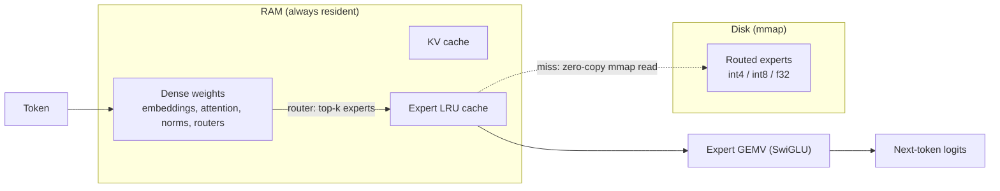

<p align="center">
  
</p>

<p align="center">
  <a href="https://github.com/Stanley03-arch/Rabbit/actions/workflows/ci.yml"></a>
  <a href="LICENSE"></a>
  
  
  <a href="https://colab.research.google.com/github/Stanley03-arch/Rabbit/blob/main/notebooks/rabbit_colab_dashboard.ipynb"></a>
</p>

<p align="center">
  <a href="#quick-start"><b>Quick start</b></a> ·
  <a href="docs/architecture.md"><b>Architecture</b></a> ·
  <a href="docs/conversion.md"><b>Convert a model</b></a> ·
  <a href="ROADMAP.md"><b>Roadmap</b></a> ·
  <a href="CHANGELOG.md"><b>Changelog</b></a>
</p>

**Local Mixture-of-Experts inference for constrained hardware.**

Rabbit is a pure-C engine that keeps the small, always-needed *dense* weights in RAM and streams
the large, rarely-needed *routed experts* from disk with `mmap` and an LRU cache. A MoE model only
touches a few experts per token, so most of its weight never has to be resident at once. The
target is machines with very little memory, down to roughly 4 GB.

Rabbit is inspired by the *idea* behind [Colibrì](https://github.com/JustVugg/colibri), a much
larger engine for frontier-scale models. It is an independent, much smaller project and not a
clone of Colibrì's code, UI or product.

> **Status: 0.4.8, pre-1.0.** The engine is correct against an independent NumPy implementation on
> small reference models. End-to-end parity on a large real checkpoint is still on the
> [roadmap](ROADMAP.md). See [What is verified](#what-is-verified) for exactly what that means.

---

## Quick start

```bash
git clone https://github.com/Stanley03-arch/Rabbit.git
cd Rabbit
make                 # builds ./rabbit  (needs only a C11 compiler and libm)
make test-model      # writes a tiny synthetic model to models/tiny-test.rabbit
./rabbit stats --model models/tiny-test.rabbit
./rabbit chat  --model models/tiny-test.rabbit
```

Synthetic weights produce structure, not language: they exist to exercise the engine. To run a
real checkpoint, [convert one](#convert-a-hugging-face-model).

Run `make help` for every build target, and `make check` to run the whole test suite.

### Memory budget

```bash
export RABBIT_MEM_BUDGET_MB=1024   # default: 1536
```

`rabbit stats` reports the model's estimated footprint against this budget as JSON.

---

## How it works



Per layer, Rabbit runs attention (RoPE, grouped-query attention, KV cache), then the router picks
the top-k experts, fetches them through the cache, and runs their SwiGLU feed-forward blocks.
Placement only affects *speed*, never numerics: an expert gives identical results whether it came
from the cache or straight from the mapped file.

Details live in [docs/architecture.md](docs/architecture.md) and
[docs/file-format.md](docs/file-format.md).

## Features

- **Memory hierarchy:** dense weights in RAM, experts via `mmap`, LRU expert cache.
- **Attention:** multi-head and grouped-query attention with RoPE, plus final RMSNorm.
- **Experts:** int4 (group-scaled, group size 32), int8 and exact f32; SwiGLU path when
  gate/up/down are present; Mixtral and Qwen-style tensor naming.
- **Tokenizer:** real byte-pair-encoding tokenizer (`RBTTOK01`), exportable from Hugging Face.
- **Converter:** Hugging Face MoE to `.rabbit`, including a streaming converter for low-RAM hosts.
- **Interfaces:** CLI, JSON stats, OpenAI-compatible HTTP API with SSE streaming, a browser
  dashboard and a simple Gradio chat.

## Interfaces

| Interface | How to run | Notes |
|-----------|-----------|-------|
| **CLI chat** | `./rabbit chat --model <path>` | Sampling via `--temp`, length via `--tokens` |
| **Stats** | `./rabbit stats --model <path>` | JSON: sizes, cache, memory estimate |
| **HTTP API** | `python tools/rabbit_server.py --model <path>` | OpenAI-compatible, SSE streaming |
| **Dashboard** | `python tools/rabbit_dashboard.py --model <path>` | Chat, memory and expert-cache view |
| **Gradio** | `pip install gradio && python tools/rabbit_ui.py` | Minimal browser chat |

### OpenAI-compatible API

```bash
pip install flask
python tools/rabbit_server.py --model models/tiny-test.rabbit --port 8080

# non-streaming
curl http://127.0.0.1:8080/v1/chat/completions \
  -H 'Content-Type: application/json' \
  -d '{"model":"rabbit","messages":[{"role":"user","content":"hello"}],"max_tokens":32}'

# streaming (server-sent events)
curl -N http://127.0.0.1:8080/v1/chat/completions \
  -H 'Content-Type: application/json' \
  -d '{"model":"rabbit","messages":[{"role":"user","content":"hello"}],"max_tokens":32,"stream":true}'
```

The server and dashboard have no authentication, so they bind to `127.0.0.1` by default. Pass
`--host 0.0.0.0` only on a network you trust.

### Dashboard

```bash
pip install flask
python tools/rabbit_dashboard.py --model models/tiny-test.rabbit
# open http://127.0.0.1:7860/
```

No local setup needed: [open it in Colab](https://colab.research.google.com/github/Stanley03-arch/Rabbit/blob/main/notebooks/rabbit_colab_dashboard.ipynb).

## Convert a Hugging Face model

```bash
pip install safetensors numpy
python tools/convert_hf_to_rabbit.py --model-dir /path/to/hf --out models/m.rabbit --layout v2 --quant 4
```

`--quant` takes `4` (group-scaled int4), `8` (int8) or `0` (exact f32). Hosts with little RAM can
use `tools/convert_hf_stream.py`, and `make live-moe` converts a small public Mixtral-style
checkpoint end to end. See [docs/conversion.md](docs/conversion.md) and
[docs/tensor-map.md](docs/tensor-map.md) for supported tensor names.

## What is verified

Rabbit's correctness claim is deliberately narrow and checkable. Each row below is a test you can
run, and `make check` runs all of them (CI runs them on Linux and macOS with gcc and clang, and
again under AddressSanitizer and UBSan).

| What | Command | What it proves |
|------|---------|----------------|
| Quantization and tokenizer | `make test` | int4/int8 kernels and BPE behave as specified |
| v1 reference model | `make parity` | C logits match NumPy within 1e-4 |
| v2 reference model | `make parity-v2` | C and NumPy produce identical greedy tokens (3 prompts x 32 tokens) |
| HF-shaped model | `make m2` | converter output decodes the same in C and NumPy |
| Exact f32 experts | `make exact-f32` | no quantization error on the f32 path |
| GQA + Mixtral names | `make mixtral-micro` | grouped-query attention and `w1/w2/w3` naming load and run |
| CLI end to end | `make smoke` | the binary starts, loads a model and chats |

**Not yet verified:** token-for-token parity against a large real checkpoint run through
`transformers`. That is the main open item in the [roadmap](ROADMAP.md).

## Repository layout

```
src/        C engine: model loader, attention, MoE, quantization, tokenizer, CLI
tools/      Converters, reference models, NumPy oracle, HTTP server, dashboard
tests/      C unit tests and C-vs-NumPy parity tests
docs/       Architecture, file format, tensor map, conversion guide
notebooks/  Colab notebooks (smoke test, dashboard, UI)
web/        Dashboard front end
```

## Limitations

- Synthetic weights do not produce real language.
- Large real MoE checkpoints still need aggressive quantization and expert limits on ~4 GB hosts.
- The context window is short; the attention implementation is built for clarity first.
- CPU only. There is no GPU runtime.
- Streaming reads engine stdout as tokens are flushed, so banner filtering is best-effort.

## Contributing

Contributions are welcome, and small focused pull requests with a test are the easiest to review.
Start with [CONTRIBUTING.md](CONTRIBUTING.md). Please follow the
[Code of Conduct](CODE_OF_CONDUCT.md), and report security issues privately as described in
[SECURITY.md](SECURITY.md).

## License

[Apache-2.0](LICENSE)
